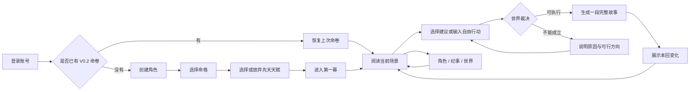

# 《问仙录》V0.2 游戏设计总纲

> 文档状态：V0.2 玩法基线
>
> 适用范围：V0.2 及后续版本的世界观、玩法、领域规则与内容生产
>
> 本文只回答“游戏是什么、世界如何运行、什么内容可以成立”。技术实现统一记录在 `docs/architecture.md`。

## 一、产品定义

《问仙录》是一款小说向、单人存档、自然语言驱动的开放式修仙文字游戏。

玩家不是在一条预写好的任务线上扮演天命之子，而是在玄墟界中成为一个有种族、有来历、有牵挂、会衰老也可能死亡的生命。玩家可以修行、谋生、游历、交易、结交、争斗、建立势力、传承道路，也可以拒绝修仙，度过完整的凡俗人生。

游戏必须同时提供四种体验：

1. **小说感**：每次行动换来一段连续、可阅读的剧情，而不是连续点按钮刷数值。
2. **自由感**：玩家可以用自己的话行动，可以离开当前事件，不被固定任务线锁住。
3. **可信感**：人物、时间、地点、能力、物品和因果保持连续，所有变化都有来源。
4. **成长爽感**：奇遇、天赋、突破、反杀和立道可以发生，但会成为持续有效的事实，并有边界与代价。

一句话定位：

> **一个会记住你一生选择的修仙世界。**

### 1.1 目标用户

- 喜欢修仙小说、互动小说和角色扮演的休闲玩家；
- 希望拥有自由行动，但不愿学习复杂数值系统的玩家；
- 愿意持续经营同一角色几十到上千回合的玩家。

### 1.2 明确不做

- 不做只有战力、装备和副本循环的数值 RPG；
- 不做玩家说什么就立刻成真的 AI 小说接龙；
- 不用固定章节数量限制玩家寿命；
- 不把所有职业、功法和事件预先枚举成封闭列表；
- 不用无意义随机死亡营造所谓残酷；
- 不让模型临时改写已经确认的世界事实。

### 1.3 传统文字游戏与 AI 的分工

传统文字游戏最重要的价值是稳定规则、资源循环、成长目标、地图边界和可反复验证的结果；AI 最有价值的能力是理解自由表达、根据当前人生组合情境、演绎独立人物，并用自然语言呈现同一规则下不同的过程。

V0.2 的基本公式是：

> **作者定义世界与矛盾，系统维持事实与演化，AI 理解行动并演绎结果。**

AI 不能代替玩法本身。没有职业、生计、关系、事件、修行和结局循环时，再长的模型正文也只是不可持续的小说接龙。

## 二、核心设计支柱

### 2.1 世界先于主角存在

玄墟界拥有固定历史、地域、势力、修炼规律和资源来源。玩家可以改变一地、一宗乃至一个时代，但不能仅凭一句话改变世界底层真相。

### 2.2 自由行动不等于自由宣布结果

玩家可以说“尝试冲击金丹”“寻找上古剑诀”“说服城主开仓”，不能直接宣布“我已经成为金丹”“背包里出现仙剑”“城主无条件服从我”。输入表达的是意图，结果由当前事实和世界规则共同产生。

### 2.3 所有长期变化都有来源

境界来自修炼和突破，能力来自天赋、传承与练习，物品来自生产、购买、馈赠、探索或夺取，关系来自共同经历。任何写入命卷的变化都必须回答：何时、何地、从何而来、付出什么。

### 2.4 世界持续流动

人物离开玩家视野后仍会成长、衰老、结亲、背叛和死亡；地方事件会继续发展；错失的机会不会原地等待。世界变化应通过传闻、书信、物价、封路、人物重逢和地点变迁重新进入玩家视野。

### 2.5 失败必须产生故事价值

失败优先形成伤势、损失、债务、暴露、关系破裂、时间错失或新的困境。只有在风险已经明确、条件足够严重时，失败才会造成死亡或断道。系统不替玩家兜底，也不以刁难玩家为乐。

### 2.6 人生可以结束，世界可以继续

一名角色可以寿尽、战死、断道、隐退、立道或完成问仙终局。完整结局不是“内容耗尽”，而是角色的一生抵达了自然终点。玩家可以封存命卷并开启另一段人生。

## 三、固定世界：玄墟界

### 3.1 世界前提

故事发生在“绝天之变”后三千年。

三千年前，最后一批飞升者在天门前失踪。此后无人能够证明仙界仍然存在，飞升通路却依旧在缓慢抽取玄墟界的灵气。宗门仍以长生之名争夺灵脉、血脉、古迹和凡人性命；妖族为祖地与血脉存续而战；灵族则在日渐衰败的天地中寻找能够继续存在的方法。

“仙是否存在、长生是否值得”是共同母题，不是强制主线。求长生、护亲友、复仇、掌权、游历、开宗、经营或安稳度日，都可以形成完整命卷。

### 3.2 幕后真相

以下内容属于世界底层真相，玩家只能通过证据逐步接近。

仙界并非天然存在的上界，而是上古修士为容纳高阶生命，以灵脉、时间、因果和众生记忆建造的世界。飞升者会逐渐成为仙界的山河、规则与灵气，个人意志在漫长岁月中被磨损。

绝天之变源于最后一批飞升者的分裂：有人要继续建造仙界，有人要摧毁天门，有人用自身固定了即将崩塌的两界。如今的天门仍在抽取玄墟界；重开、摧毁、接替或重建都没有无损答案。

“问仙录”最初是一位凡人史官留下的残卷。他发现被天门剥离的人会逐渐从亲友记忆与历史中消失，于是记录每一个曾向仙路发问的名字。每份玩家命卷，都是残卷保存下来的一段人生。

### 3.3 四方地域

| 地域 | 核心气质 | 主要矛盾 | 代表势力 |
|---|---|---|---|
| 东陆九州 | 王朝、城镇、宗门、商路 | 凡俗秩序与宗门资源争夺 | 九宗盟、诸国王朝 |
| 北荒妖原 | 部族、荒野、血脉、领地 | 祖地存续、强族压迫与人妖边界 | 百妖庭、诸部族 |
| 南溟群岛 | 海路、散修、潮汐、水府 | 航路、海兽、岛屿资源与失落遗迹 | 问天司、海商、岛宗 |
| 西境灵墟 | 古战场、裂隙、灵族遗民 | 古物污染、空间破碎与族群存续 | 灵墟古族、守墟人 |

四方地域是固定骨架。州、城、宗门、山川、商路和秘境构成可扩展的地方层。正式进入命卷的地点必须保持名称、归属、相对位置、交通和历史连续。

### 3.4 核心势力原则

- 势力有目标、资源、内部派别、盟敌和承受能力，不是善恶标签；
- 玩家可以加入、利用、背叛、改变或远离势力；
- 势力不会为了主角永久停止，也不会因一句威胁立刻屈服；
- 势力被摧毁后，其土地、债务、敌人、传承和幸存者仍会产生余波。

首批固定势力为九宗盟、百妖庭、问天司和灵墟古族。具体宗门、国家、部族和商会通过地域内容包逐步开放。

## 四、三族与生命成长

### 4.1 种族不是换皮

首期可选人族、妖族、灵族。三族生活在同一世界，但身体、寿命、感知、社会处境与修行方式不同。

| 种族 | 生命根源 | 主要优势 | 固有困境 |
|---|---|---|---|
| 人族 | 凡俗血肉与后天修行 | 传承多、社会网络广、改修灵活 | 寿命短，依赖资源和师承 |
| 妖族 | 兽类、草木或异种血脉开智 | 肉身、本命天赋、自然适应 | 血脉压制、祖性侵蚀、族群偏见 |
| 灵族 | 矿石、器物、山川、火焰或现象生灵 | 与本体根源高度契合、寿命漫长 | 成形困难，本体与环境受损即伤及生命 |

角色根源一旦确定便是权威事实。矿石成精的灵族必须始终保留矿石本体、特殊感知和生存需求，不得在后续剧情中被写成普通人族。

### 4.2 三族境界

三族不共享对外显示的境界名称。系统内部只用“生命层次”比较大致影响范围，不把三族换算成完全相等的战斗单位。

| 生命层次 | 人族 | 妖族 | 灵族 | 发生的根本变化 |
|---|---|---|---|---|
| 未脱凡性 | 凡俗 | 开智 | 萌灵 | 拥有连续自我，但尚未稳定运用灵机 |
| 初纳灵机 | 引气 | 启灵 | 聚识 | 第一次主动运转超凡力量 |
| 稳固根基 | 筑基 | 淬血 | 定形 | 确立可持续成长的根基 |
| 凝成内核 | 金丹 | 妖丹 | 灵核 | 形成稳定的力量与生命核心 |
| 真我独立 | 元婴 | 真形 | 真名 | 自我不再完全受出生载体定义 |
| 触及天地 | 化神 | 返祖 | 显圣 | 个人存在开始影响天地与众生 |
| 展开自身 | 炼虚 | 天妖 | 化域 | 能让一片空间承载自身规则 |
| 以道改世 | 合道 | 妖圣 | 天成 | 自身道路足以长期改变世界 |

每一境使用“初成、稳固、圆满”描述进展，不显示经验条或升级百分比。

### 4.3 境界与道路分开

境界说明生命发生了什么变化；修炼道路说明角色用什么方式获得并使用力量。道路从功法、师承、长期行为和突破选择中形成，不在创角时永久锁定。

- 人族可以走练气、炼体、剑道、神魂、丹符阵器或以凡技入道；
- 妖族可以走返祖、异脉、本命神通、领地共生、族群图腾或斩祖自立；
- 灵族可以淬炼本体、经营香火、契约共生、吞纳同源、化身游历或脱离本体。

道路允许兼修，但时间、资源和内部冲突必须真实存在。职业、境界、道路和势力身份是四个不同维度，不能混为同一个“职业系统”。

### 4.4 修炼成立的五项条件

1. **根基**：灵根、血脉、本体或后天改造是否适合；
2. **传承**：功法、师承、仪式或可参悟载体是否存在；
3. **资源**：灵气、材料、丹药、领地和安全时间是否足够；
4. **实践**：角色是否真正练习、使用并理解这条道路；
5. **契机**：当前生命变化是否已经形成必须回答的关隘。

闭关可以积累，不保证突破。缺少条件时，角色仍可获得经验、熟练、身体改善或发现缺口，但不能凭空跨越大境界。

### 4.5 突破是一项长期工程

一次大境界突破由“发现关隘—准备条件—选择道路—承担风险—正式突破—消化余波”组成。玩家可以中断、改道或长期延后。

每一生命层次都对应一道会回收过往经历的“道问”：

| 生命层次 | 道问 |
|---|---|
| 初纳灵机 | 你第一次主动使用天地之力，是为了什么？ |
| 稳固根基 | 你愿意以什么作为此后成长的根基？ |
| 凝成内核 | 有什么是力量与长生也不能交换的？ |
| 真我独立 | 当出生载体不再能定义你，什么证明你还是你？ |
| 触及天地 | 当你的存在足以改变众生，什么约束你？ |
| 展开自身 | 当现实可以被你的道路改写，什么仍值得相信？ |
| 以道改世 | 如果你将成为一条规则，你允许什么，又拒绝什么？ |

道问没有标准善恶答案。系统要求的是角色承担自己的答案，而不是把玩家导向固定正派结局。

## 五、核心玩法循环

### 5.1 命卷创建

创建一份 V0.2 命卷时依次确认：

1. 姓名、性别表达与种族；
2. 角色根源，例如人族家庭与地域、妖族本相与族群、灵族本体与苏醒方式；
3. 此生所求，例如长生、守护、复仇、自由、求知、掌权或安稳度日；
4. 普通或困难难度；
5. 三份符合上述事实、但身份、关系、旧债和开场危机不同的命格；
6. 一到三项符合根源的低阶天赋，可选其一、重抽一次或不携带天赋。

姓名候选必须同时符合种族、性别表达、地域和身份。玩家自定义姓名可以更自由，但不能携带系统指令或直接宣布高阶身份。

种族、本体、姓名和此生所求是命格生成的硬事实，三份候选只能改变生活处境，不能把矿石灵族写成人族孤儿，或把妖族本相静默改成另一物种。确认命格后才开始世界时间。

开局前三个正式回合允许玩家补充尚未冲突的普通背景细节；高阶能力、巨额资产和既成战果仍必须通过游戏获得。

### 5.2 单回合循环

1. 玩家阅读上一行动形成的连续章节；
2. 世界同步时间、位置、人物、资源、关系和事件变化；
3. 系统提供二至四个真正有差异的行动建议；
4. 玩家点击选择，或输入自己的行动；
5. 行动得到成功、有代价的成功、局部推进、失败、不成立或需要补充；
6. 结果形成新的处境、牵挂和可行动空间。

普通回合应覆盖二至四个连续场景，目标阅读时长约三至五分钟。寒暄、短距离移动、普通采买和无风险操作可以自然合并；只有会明显改变命运、资源、关系或风险的节点才要求下一次选择。

### 5.3 六条长期循环

长期内容不依赖固定章节数，而由六条能够互相组合的循环持续供给：

1. **生计与经营**：谋生、交易、制作、店铺、领地、产业与债务；
2. **修行与突破**：寻找传承、准备资源、练习能力、解决关隘；
3. **人物与传承**：亲友、师徒、伴侣、仇敌、后代、寿命与遗愿；
4. **探索与迁徙**：地方异闻、遗迹、商路、秘境、跨域和归乡；
5. **势力与秩序**：加入、晋升、夺权、改革、开宗、战争与治理；
6. **问仙与立道**：搜集绝天证据、形成自身答案、影响天地或留下传承。

玩家可以长期专注其中一两条，也可以在不同人生阶段切换。六条循环必须共享同一批人物、地点、资源与因果，不能变成六个互不相干的小游戏。

### 5.4 自由活动原则

玩家随时可以离开当前事件，前提是当前没有真实存在的围困、追杀、契约、伤势或交通限制。拒绝参与大事件是有效选择，但事件会自行发展并留下结果。

系统不使用“必须完成当前任务才能离开”的隐形墙，也不因玩家偏离预设方向而强行把剧情拉回主线。

### 5.5 内容尺度随人生变化

游戏不按回合数解锁章节，而按角色真实能力、身份和关系改变可接触的事件尺度：

| 人生尺度 | 主要体验 | 可影响范围 |
|---|---|---|
| 入世 | 求生、认识自身、第一次接触超凡 | 家庭、街巷、村镇 |
| 立足 | 传承、生业、同伴、长期敌人 | 城镇、宗门支脉、部族 |
| 入局 | 势力冲突、跨地域行动 | 州郡、宗门、商路、战场 |
| 主事 | 建立组织、制定规则、承担群体命运 | 一方地域、多个势力 |
| 问道 | 建立自身道路、处理长生代价 | 大域、时代与修行秩序 |
| 问仙 | 面对天门真相和一生因果 | 玄墟界的未来 |

这些不是强制章节。凡俗商人可以成为一州主事，高阶修士也可能选择隐居经营一间药铺。

## 六、长期事件框架

### 6.1 三条持续流动的事件线

每份命卷同时运行三条事件线：

- **世界事件**：灾年、兽潮、战争、宗门更替、灵脉变迁、潮汐和天门异象；
- **人物事件**：成婚、离乡、拜师、复仇、突破、继承、衰老和死亡；
- **修行事件**：天赋觉醒、功法冲突、突破关隘、血脉躁动、本体受损和道念变化。

三条线可以在同一回合相遇，但同时压迫玩家的主事件不宜超过一个，避免每一章都像任务列表。

### 6.2 世界事件生命周期

一场正式大事件必须经历：

```text
种子 → 征兆 → 酝酿 → 爆发 → 转折 → 结果 → 余波
```

玩家可以在任意阶段介入，也可以完全错过。事件的结果由参与人物、势力资源、玩家行为和此前变化共同决定，不为等待玩家而暂停。

事件分为四个尺度：

| 尺度 | 示例 | 常见持续时间 |
|---|---|---|
| 地方 | 矿难、失踪、疫病、家族争斗 | 数日到数月 |
| 区域 | 商路断绝、宗门内乱、部族迁徙 | 数月到数年 |
| 大域 | 王朝战争、兽潮、灵脉大衰 | 数年到数十年 |
| 时代 | 天门复苏、天地规则变化 | 数十年到数百年 |

高阶角色不是继续重复低阶跑腿，而是逐渐成为事件的主事者、制定者或被时代针对的人。

### 6.3 阶段性大事

每个生命层次都准备一组与种族、道路和人生经历相关的大事，但不绑定固定回合或唯一地点。例如：

- 人族筑基面对道基选择，妖族淬血面对血脉方向，灵族定形面对本体与化身关系；
- 金丹、妖丹和灵核阶段都要形成内核，但材料、风险和人生问题不同；
- 元婴、真形和真名阶段共同追问“何为真我”，却通过完全不同的生命体验回答。

大事提供压力和机会，不替玩家决定人生。玩家可以延后、绕行、以罕见方式解决，或者放弃继续晋升。

### 6.4 千回合内容来源

一千回合不等于人工编写一千章。长线内容来自：

- 固定地域、势力和世界真相提供不会漂移的骨架；
- 人物拥有目标、寿命、关系和日程，会自行产生人生变化；
- 大事件拥有生命周期，结束后会改变地点、价格、权力与人物处境；
- 职业、修行、关系、探索和势力循环可以交叉组合；
- 时间尺度会从日、月扩大到年、十年与世代；
- 玩家建立的宗门、家族、店铺、领地和传承会成为新的内容源；
- 已结束事件留下债务、废墟、后代、传说与报复，而不是从世界中消失。

长期游玩的目标不是永远拖延结局，而是让角色在不同阶段面对不同层级的问题。角色完成一生后，命卷应允许自然收束。

### 6.4.1 真实玩家行动基线

V0.2 的长线验证不再只让角色重复等待。2026 年 8 月 3 日对 V0.13 的 42,547 个历史回合做了只读、匿名聚合：约 80% 是点击系统选项，约 20% 是玩家自由输入。按照精确选项类型和匿名语义抽样推算，玩家主要行动依次为调查、人物互动、赶路、修炼，其后才是等待、能力使用、战斗、物品使用、其他行动和交易。

这份分布只用于形成测试权重，不把旧版剧情事实迁入新世界，也不把少数千回合玩家的偏好误写成所有玩家的玩法。测试语料不保存邮箱和原始行动文本；自由输入中的复合行动、长期行动、人物关系、学习能力、突破、背包变化、强行宣告结果和越界移动作为额外风险场景单独验证。

因此“千回合通过”必须同时说明测试内容：三族共同覆盖上述行动，经过正式裁决、领域校验、原子提交和数据库持久化；人物、地点、关系、境界、能力、背包、钱包、时间和青岐州边界均保持一致。单纯重复等待一千次只证明时钟和存储耐久，不代表玩法已经足够丰富。

### 6.5 结局与通关

游戏同时承认三种完成方式：

- **人生结局**：角色完成、放下或彻底失去此生所求，可以选择隐退、寿终或封卷；
- **传承结局**：角色建立了能够脱离自身继续存在的家业、族群、宗门、道路或弟子传承；
- **问仙结局**：角色触及天门真相，并以重开、摧毁、接替、重建或拒绝参与给出答案。

死亡与断道也会形成完整终卷，但不等同于系统惩罚页面。终卷回收此生所求、人间锚、重要关系、未偿因果、留下影响和世界评价。

当角色具备结局条件时，系统只提示“此生可以在此收束”，不强制结束。玩家确认封卷后命卷永久只读；未确认前可以继续生活和处理余事。问仙结局不是所有角色的唯一通关方式。

## 七、职业、天赋、功法与技艺

### 7.1 职业是社会身份，不是固定职业栏

职业表示角色靠什么谋生、服务谁、能接触哪些资源，以及被谁承认。玩家不在创角时永久选择职业，可以拜师、转行、兼业、失业、被逐或自创一门生业。

一项职业由知识、手艺、工具、资格、关系和生计六部分组成。只要这六项能够成立，玩家提出的新职业就可以进入世界，无需预先收录在封闭列表中。

职业群只用于提供内容方向：山野生计、城镇手艺、商旅交通、王朝百业、江湖暗面、修行战斗、修行生产、修行知识、宗门事务与族群职责。不同种族会以不同身体和社会关系从事同一职业。

### 7.2 天赋

天赋是与生俱来或由本体根源自然拥有的长期特征。每项天赋必须具有：表现、适用范围、明确边界、代价或条件，以及可成长方向。

天赋被命卷接受后必须持续有效。低阶天赋可以随经历觉醒或变异，但新形态必须保留与原始根源的联系。玩家可见描述保持小说化，不展示百分比、冷却或系统公式。

### 7.3 功法与能力

- **根本功法**：决定力量如何运转以及根基如何形成；
- **术法与神通**：消耗力量实现具体效果；
- **武技与身法**：依靠肉身、兵器和技巧；
- **神魂法门**：感知、梦境、心神和灵魂防护；
- **生产技艺**：炼丹、制符、阵法、炼器、医术、卜算等。

能力使用“初识、掌握、熟练、圆满”描述掌握程度。得到秘籍只代表拥有载体，不代表已经学会；卖掉秘籍不会自动遗忘已掌握内容。

### 7.4 自创与传承

长期使用、改造和验证一组能力后，角色可以形成自创技法、功法或完整道路。自创内容必须继承已有能力来源，记录解决了什么问题、适合谁、有什么代价，并通过实际使用逐步稳定。

传承可以留给弟子、家族、宗门、器灵或后世记录，成为角色结局和后续世界影响的重要组成。

## 八、物品、经济与生产

### 8.1 物品连续性

每件重要物品至少具有名称、类别、数量或唯一性、来源、持有者、状态和已知用途。获得、消耗、出售、赠送、遗失和损坏必须形成对应变化。

普通消耗品可以堆叠；法宝、秘籍、信物、遗物和剧情关键物品使用独立记录。页面只负责展示，所有使用行为仍从历练页发起。

### 8.2 钱包与货币

- 凡俗货币以文为最小单位：一千文约合一两银，十两银约合一两金；
- 修行货币使用下品、中品、上品灵石，常见兑换为一百进一，但不同地域和局势允许产生价差；
- 凡俗钱财和灵石不能无来源互换；
- 购买必须同时扣款并获得物品，出售必须同时失去物品并获得货币；
- 角色可以负债，但不能把负债伪装成钱包中的负数余额。

### 8.3 经济锚点

每个地域维护基础生活、交通、材料、劳务和修行资源的价格带。事件可以让价格变化，但必须有稀缺、运输、权力或供需原因。同一地区短期内不允许出现无法解释的数十倍跳价。

生产不是按按钮凭空造物。配方、材料、工具、场所、技艺、时间和失败后果共同决定产出。稳定生产后可以形成生计、声望、客户和产业，而不只是一次获得物品。

## 九、人物与关系

### 9.1 NPC 是独立人物

每个正式具名人物都有种族、年龄、身份、目标、性格边界、能力、位置、关系、已知信息和个人日程。未登场期间，重要 NPC 仍会依照这些事实变化。

人物不会因为玩家需要就永久等待、无条件信任或突然降智；也不会为了制造冲突而违背已经建立的性格与利益。

### 9.2 关系不是好感度

关系由多个可解释维度组成：身份关系、信任、亲近、敬畏、利益、债务、冲突与共同秘密。玩家页面用自然语言总结，不显示单一百分比。

救命之恩不等于爱情，师徒关系不等于服从，利益同盟也可能彼此厌恶。关系变化必须由具体互动与事件产生。

### 9.3 人间锚与因果债

角色会形成少量“人间锚”：一个人、一件旧物、一处故乡、一句承诺或一个旧名字。它们不提供直接战力，而是在漫长寿命、心魔、夺舍和高阶变化中证明角色仍与某段人生相连。

因果债记录未结束的交换：救命之恩、债务、背叛、血仇、师承责任和誓言。玩家可以拒绝偿还，但拒绝本身会影响人物、势力与最终命卷评价。

## 十、地图、时间与知识

### 10.1 地图层级

地图分为大域、地域、地点、场景四级。大域和地域是长期地理事实；地点包括城镇、宗门、山脉、岛屿与秘境；房间、街巷、摊位和洞府内室属于当前场景。

场景可以在章节中自然切换，地点迁移必须存在距离、路线、交通方式和时间。跨域、传送和强制带离必须有已经存在的能力、阵门、人物或事件来源。

### 10.2 统一时间

每份命卷只有一条权威世界时间线，每年十二个月、每月三十日。所有人物、事件、价格、移动、闭关和寿命都以此为准。

玩家明确等待、赶路或闭关时，应按实际时长推进。中途被打断时必须说明打断原因与已经经过的时间。高阶人生允许一次跨越数年或数十年，但必须结算人物、势力、资源和人间锚的变化。

### 10.3 玩家知识边界

世界真实状态与玩家已知状态分开。玩家只能使用通过亲历、调查、传讯、可信传闻、能力或推演获得的信息。未知 NPC 的境界、秘密计划和远方事件不能因为系统知道就直接写给玩家。

传闻可以错误，来源与可信度必须可追溯。错误情报不是系统事实漂移，而是世界中的人物认知差异。

## 十一、冲突、风险与死亡

### 11.1 冲突结果

冲突不只包含战斗，也包括谈判、追踪、炼制、突破、逃亡和经营。结果由能力层次、已掌握手段、身体状态、情报、准备、人数、环境、目标和愿意付出的代价共同决定。

### 11.2 战斗边界

境界提供基础压制，不直接决定全部胜负。相差两个大生命层次时形成强边界：低阶角色不能无铺垫正面击杀高阶角色，高阶角色也不能因普通失误被低阶角色随意反杀。

越级结果必须依赖此前已经存在的重伤、克制、阵法、人数、地形、情报或一次性代价，并真实消耗这些条件。撤退、拖延、救人、夺物和试探可以在无法击杀对手时仍然成功。

### 11.3 难度

- **普通**：风险会提前显露，普通失败更多转化为可继续承担的后果；
- **困难**：资源更紧，敌人更主动，伤势与失误后果更持久，但仍遵守风险可感知原则。

难度不改变世界真相和境界规则，只改变信息宽容度、资源压力和失败代价。

### 11.4 死亡

死亡必须来源于明确的危险链：风险出现、玩家获得感知机会、角色选择承担、条件恶化、最终结算。突发事件可以致命，但不能毫无铺垫地把普通行动变成必死陷阱。

死亡后生成终卷，记录人生所求、重要关系、未偿因果、留下传承和死亡原因。命卷进入只读档案，不自动重生或回档。

## 十二、领域规则总表

以下规则是所有玩法和内容必须遵守的共同契约。

### 12.1 身份规则

- 角色的种族、根源、本体、姓名和已确认经历不能被后续叙事静默改写；
- 伪装、化形、失忆和夺舍只能改变表象或认知，不能抹除底层事实；
- 新身份必须有获得、承认与失去的过程。

### 12.2 行动规则

- 玩家提交的是意图，不是结果；
- 行动必须区分使用、尝试、寻找、学习、询问、交易、移动和声明结果；
- 对象不明确时要求补充，事实冲突时说明原因，不生成无关替代剧情；
- 不成立与需要补充不推进正式时间，也不消耗正式回合。

### 12.3 状态规则

- 所有持久变化必须由事件产生，并记录来源；
- 一次行动涉及多个人物、物品和关系时必须整体结算，不能只更新主角；
- 正文描述与最终状态冲突时，本轮不得悄悄保留其中一半；
- 已确认的死亡、消耗、出售、离开和突破不可在后文自动撤销。

### 12.4 成长规则

- 大境界只能按本种族相邻阶段推进；
- 功法名称、正文形容和玩家自述不能单独改变境界；
- 天赋和能力一旦被接受，必须写入角色能力记录；
- 高阶能力必须有传承、觉醒、自创或事件来源。

### 12.5 时间与地点规则

- 时间变化影响所有相关人物和事件；
- 长时间行动必须结算离场人物与世界变化；
- 地点迁移必须说明方式、路线和耗时；
- 场景变化不得误写成跨地点移动。

### 12.6 资产规则

- 钱包、物品、秘籍知识和已掌握能力相互独立；
- 交易必须双向结算，消耗必须真实移除；
- 重要物品必须记录唯一来源与当前持有者；
- 不允许仅在正文里赠送、出售或使用而不改变权威状态。

### 12.7 人物规则

- 每个具名人物进入独立档案；
- 人物实际状态与玩家所知状态分开；
- 人物行为必须同时符合目标、性格、能力和当前处境；
- 时间跨度后再次出现时，年龄、身份、位置和关系必须重新结算。

### 12.8 事件规则

- 事件有前因、参与者、阶段、时限、结果和余波；
- 玩家不参与时，事件也会继续；
- 已结束事件不能原样重复，余波可以形成新事件；
- 新生成的长期实体一经确认即成为该命卷的正式事实。

### 12.9 知识规则

- 叙事只使用玩家已知或当前可感知的信息；
- 推断必须被表述为推断，传闻必须保留来源；
- 幕后真相不能因模型知道而提前泄露；
- 调查可以改变知识状态，不必立即改变世界真实状态。

## 十三、内容生产框架

### 13.1 三层内容

| 层级 | 内容 | 变化方式 |
|---|---|---|
| 世界正典 | 世界历史、三族规则、四方地理、核心势力、绝天真相 | 只随正式版本更新 |
| 地域内容包 | 地点、势力分支、代表人物、资源、职业生态、事件模板、线索碎片 | 按版本持续扩充 |
| 命卷实例 | 玩家影响的人物、地点状态、事件结果、自创传承与新组织 | 在单一存档中持续演化 |

模型可以补充命卷实例，不能改写世界正典。新内容一旦对玩家产生持久影响，就必须登记为命卷事实，之后不能只依赖聊天上下文记忆。

### 13.2 地域内容包标准

每个可开放地域至少包含：

- 一条清晰的生存与经济生态；
- 三到五个有矛盾的固定势力或群体；
- 一组有自身目标和寿命的代表人物；
- 六类长期循环都能接入的地点与资源；
- 地方、区域、大域三个尺度的事件种子；
- 与绝天之变有关但不强制追查的证据；
- 人、妖、灵三族各自合理的进入方式；
- 事件结束后的至少两类余波。

内容包不是封闭章节。它提供可组合的事实、矛盾和事件语法，使玩家重复进入同一地域时仍可能形成不同人生。

### 13.3 事件模板标准

事件模板定义触发条件、参与角色、资源冲突、阶段变化、可能结果、可见征兆和余波类型，不预写唯一结局。正式生成时再绑定当前命卷中的人物、地点和历史。

模板不能只替换人名重复使用。相同事件再次出现时，必须因时代、参与者、旧债、势力格局或地点状态产生实质差异。

### 13.4 人物生成标准

具名人物至少拥有：想得到什么、害怕失去什么、当前正在做什么、不会轻易做什么、与谁存在关系、在什么时间会发生变化。

一次性路人可以简化；一旦与玩家建立关系、持有重要物品、参与事件或再次登场，就升级为正式人物。

### 13.5 叙事生成标准

- 正文服务于已经成立的世界结果，不在 prose 中偷偷创造高阶事实；
- 每章至少完成一个小目标或显著改变局势；
- 选项必须在目标、风险或价值取向上存在区别；
- 不用连续悬念代替实际推进；
- 不重复概述玩家已经读过的上一章；
- 不展示模型、接口、概率、Token 或内部规则术语；
- 重要章节可以自然写长，普通章节不为满足固定字数重复描写。

### 13.6 内容扩展顺序

V0.2 不追求一次填满四方世界，按以下顺序扩展：

1. 做深一个起始地域，使六条长期循环都能运转；
2. 补足三族在该地域的不同开局与长期路径；
3. 验证人物离场演化、事件生命周期和十年以上时间跨度；
4. 开放相邻地域和跨地域经济、关系与事件；
5. 最后开放大域级和天门级内容。

新增内容优先增加可复用的地点、人物关系、职业生态和事件模板，不优先堆只消费一次的线性章节。

## 十四、V0.2 首发范围

### 14.1 起始地域：青岐州

青岐州位于东陆与北荒交界，既有凡人城镇、矿脉、药山和小宗门，也有妖族旧领与沉睡灵物，适合三族在同一世界规则下形成不同开局。

首批固定内容包括：

- 青木镇及东门、集市、回春堂，照骨矿及深处，百草岭、芦水渡、废火窑、青铜门外院等 14 个可持续扩展的地点；
- 凡俗官府、矿商、地方宗门、妖族小部和守墟遗民五类利益方；
- 10 类基础物品、14 项天赋/功法/生活技艺及对应地域价格锚点，覆盖生计、修行、人物、探索、势力和问仙六条循环的早期入口；
- “照骨矿异动”“青木药荒”“北路商队迟滞”“青铜门外院招募”四类区域事件，玩家可以参与、旁观或完全错过。

### 14.2 三族开局差异

- **人族**从家庭、债务、师承或凡俗生业进入青岐州；
- **妖族**从领地、族群、化形或被追猎处境进入；
- **灵族**从本体苏醒、被开采、被持有或环境衰败进入。

三族可以遇见同一事件，但看到的信息、能够采取的行动和承担的风险必须不同。

### 14.3 首发验证目标

V0.2 首发必须验证：

- 同一角色连续一百回合仍保持人物、地点、能力和关系一致；
- 玩家离开区域事件后，事件能够自行发展并留下可见余波；
- 三族可以沿不同境界逻辑完成第一次大境界变化；
- 玩家能够通过至少三种非战斗方式建立长期生活；
- 一次跨年行动能正确更新人物、事件、经济与关系；
- 角色可以形成死亡、隐退、凡俗寿终或阶段性立道结局；
- 内容扩展不需要修改游戏核心规则。

自动化验收同时使用 V0.13 匿名行动分布：一千回合按调查、互动、赶路、修炼、等待、能力、战斗、物品、其他和交易混合执行，并平均分配给人、妖、灵三族。三族必须沿各自相邻境界达到金丹、妖丹、灵核，且不以越界、负资产、遗失能力或人物重置换取通过。

首发不以“人工写完多少章”为验收标准。

## 十五、V0.2 H5 体验基线

### 15.1 保留的视觉方向

V0.2 延续现有“墨卷纪事”视觉语言：宣纸、水墨、青绿强调色、朱砂风险色、日夜阅读主题和文学化排版。它已经形成《问仙录》的辨识度，不因重构改成传统网游面板。

保留的是视觉语言和成熟交互，不是现有页面代码结构。V0.2 可以重新组织组件、数据加载和页面层级。

在手机端，页面直接占满浏览器可视区域，不使用手机外框、模拟状态栏或模拟键盘；在宽屏端保留满屏水墨背景，将正文限制在舒适阅读宽度，避免把手机版机械拉宽。

### 15.2 体验主线

V0.2 的页面围绕一条主线组织：



登录后的默认去向遵循以下规则：

- 没有 V0.2 命卷时直接进入创角；
- 只有一份在世命卷时直接恢复上次阅读位置；
- 有多份命卷时仍优先恢复上次使用的命卷，顶部入口可随时切换；
- 存在未完成的回合任务时直接恢复推演状态，不重复提交；
- 公告、账号、命卷管理和推演设置不阻断正常阅读，只有必须确认的维护信息使用弹窗。

### 15.3 创建角色流程

创角不使用一张超长表单，拆成四个连续步骤，每一步都能返回修改：

1. **此身为何物**：先选人族、妖族或灵族，再选性别表达；种族卡重点解释起点差异，不展示复杂数值。
2. **如何称呼**：支持自定义姓名与随机雅名；随机姓名必须同时参考种族和性别。条件不完整时按钮给出明确提示，不能点击后无反应。
3. **从何处来、为何而活**：填写或选择出身根源、此生所求、未偿旧债与难度。自由设定只决定合理的起点事实，不能直接赠予高阶修为。
4. **命数初显**：系统生成三份符合已选种族的命格；选定后再出现一至三种先天天赋候选，玩家可以选一种，也可以不带天赋入世。

最终确认页只展示会成为权威事实的内容：姓名、种族、性别、命格、根源、所求、旧债、难度与所选天赋。进入第一幕后这些事实不能被正文静默改写。

创角期间的推演使用整页水墨过场，明确显示“正在推演命格”“正在寻找先天灵光”“正在落印入世”，避免静止页面让玩家误以为按钮失效。

### 15.4 全局页面结构

游戏内保持四个底部页面：

| 页面 | 首屏回答的问题 | 深入内容 |
|---|---|---|
| **历练** | 我在哪里、刚发生了什么、接下来能做什么 | 正文、对话、本回变化、建议行动、自由输入 |
| **角色** | 我是谁、走到哪一步、手中拥有什么 | 此身、修行、行囊、人物四组资料 |
| **纪事** | 这段人生真正发生过什么 | 选择、人物、修行、世界事件与阶段总结 |
| **世界** | 我知道什么地方、哪些大事正在发展 | 地点、势力、传闻、线索与可到达方向 |

顶部始终只保留三类信息：当前命卷、世界时间与地点、卷外设置。当前命卷入口负责切换在世角色和查看 V0.13 只读档案；卷外设置负责账号、公告、阅读外观、推演方式和密钥，不继续堆放在世界页，也不增加第五个底部页面。

角色、纪事与世界页都是阅读和检索视图，不放置“使用”“出售”“修炼”等会消耗回合的按钮。玩家若要使用物品、施展功法、与人物交谈或前往某地，统一回到历练页表达行动。

### 15.5 历练页与单回合体验

历练页从上到下保持六层：

1. **场景眉题**：章节题目、当前地点与场景时刻；
2. **连续正文**：以小说排版承载一段完整情节，不拆成聊天气泡；
3. **本回变化**：只在确有变化时出现，用自然语言说明时间、地点、物品、能力、关系和事件变化；
4. **局势提示**：呈现玩家已经知道的机会、危险和期限，不显示后台权重或百分比；
5. **建议行动**：提供二至四个方向，内容必须完整换行，不得省略号截断；
6. **唯一行动框**：支持自由输入，也可引用物品、功法、人物或地点名称后再发送。

建议行动不是剧情菜单边界。正常阅读状态下，点击建议会直接提交并开始推演；自由行动通过输入框提交。两者在服务端仍走同一套行动解释和裁决流程，不形成两套游戏规则。

行动框使用可自动长高的原生输入控件，默认一至两行、最多四行。输入框获得焦点或已经存在草稿时，页面进入“自由行动模式”：建议选项立即收起并禁止点击，只保留一条“查看推荐行动”的折叠入口，防止键盘弹起和页面位移导致误触。退出输入、清空草稿或主动点击该入口后，建议选项才恢复。

手机键盘弹起时，行动框固定在可视区域底部并使用不透明背景与正文隔开，底部导航暂时隐藏；键盘收起后恢复导航。不同命卷分别保存自己的未发送草稿。

成功回合结束后，页面定位到新章节标题而不是正文最底部，让玩家从本章开头开始阅读；玩家读到末尾后才看到变化、选项和行动框。这样减少等待后的视觉跳动，也避免玩家跳过正文。

### 15.6 裁决、等待与失败

自由行动存在三种正常结果：

- **成立**：推进一段完整剧情并写入状态；
- **需要说明**：指出缺少的对象、地点或目的，保留原草稿，不消耗回合；
- **无法成立**：以“此举为何不能成立”说明冲突事实，并给出一至三条符合当前世界状态的实现路径，不生成无关剧情，不消耗回合。

玩家提交行动后立即出现“命卷推演”状态。主页面依次显示“理解此举”“结算人物与世界”“续写本回”“保存命卷”，不展示虚假的百分比或精确倒计时。跨页面保留一条轻量状态栏，说明哪份命卷正在推演；玩家可以阅读其他页面或关闭浏览器，返回后继续恢复同一任务。

首版不提供取消生成按钮，避免模型已经产生费用后玩家误以为取消可以退回消耗。失败时保留行动草稿和当前命卷状态：可安全重试的失败提供“重试本次推演”，需要玩家处理的问题直接说明原因，并附一个可复制的问题编号。

### 15.7 角色页

角色页首屏只展示姓名、种族境界、年龄、当前身份、所在地与一句身体状态，不展示体力条、悟性分数、追查百分比或综合战力。

长内容分为四组局部页签或折叠段：

- **此身**：命格、根源、所求、旧债、身份与身体；
- **修行**：本族境界、当前阶段、突破条件、天赋、功法、术法与掌握来源；
- **行囊**：凡俗钱财、各品灵石、物品数量、状态、来源与重要用途；
- **人物**：人间锚、已登场人物、关系性质、最后确认时间与已知去向。

物品和能力详情允许展开阅读，但不提供直接操作按钮。页面只呈现服务器确认的事实；“可能有效”“传闻用途”必须与已确认能力区分。

### 15.8 纪事页

纪事不保存每一个微小数值变化，而记录足以影响人生的事实。首屏展示统一世界时间和最近的重要纪事，可按“全部、抉择、人物、修行、世界”筛选。

每条纪事包含发生时间、地点、参与人物、结果与来源回合；点击后可以回看对应章节。跨年闭关、长期旅行和阶段事件使用时间段展示，不拆成大量重复日记。角色死亡、隐退或完成阶段目标后生成一页可阅读的“一生纪略”，并允许封存而不是自动重生。

### 15.9 世界页

首版世界页不做自由拖拽地图，以稳定的“地域卷轴”呈现：

- 当前地点及其州、郡、城、具体场景层级；
- 已知地点与可到达方向；
- 正在发展的地域大事及玩家已知期限；
- 已知势力、人物、传闻和未解线索；
- 玩家曾经到过但已经发生变化的地方。

世界页只展示玩家已知信息。未知人物真实位置、秘密事件结果和后台演化状态不能提前泄露；不确定消息明确标为传闻及其来源。

### 15.10 命卷与卷外设置

命卷入口采用独立抽屉或全页命卷架，展示每份在世命卷的角色名、种族境界、地点、世界时间、回合与当前任务状态。切换后四个页面必须一起切换，不能继续展示上一角色的回合、正文或草稿。

封存属于低频且不可逆操作，只能在命卷管理中完成，需要再次确认角色名。已死亡、隐退和主动封存的角色进入档案，不占在世命卷名额；V0.13 档案明确标注“旧版只读”，不与 V0.2 数据混合。

卷外设置分为五组：

- 账号与安全；
- 推演方式与自己的密钥；
- 赠送回合与当前使用来源；
- 阅读主题、字号与跟随系统；
- 公告、版本纪事和帮助反馈。

危险操作集中放在账号与命卷管理底部，不与高频阅读选项并排。

### 15.11 玩家模型选择

V0.2 首版接入 DeepSeek Flash 与 DeepSeek Pro。玩家在卷外设置的“推演方式”中看到两种凭据来源：平台推演与自己的 DeepSeek 密钥。

平台推演使用运营当前配置的模型，玩家能够看见实际模型但不能自行改写平台路由；使用自己的密钥时，玩家可以选择：

- **灵思·迅捷（Flash）**：等待更短、花费较低，作为默认选择；
- **灵思·深演（Pro）**：更适合重要剧情与复杂行动，等待和消耗更高。

界面可以使用世界观名称，但必须同时清楚标注实际模型，避免玩家无法判断费用。拥有自备密钥时可自行切换 Flash 与 Pro，切换从下一回合生效，不影响正在生成的内容，也不会让系统擅自改用平台额度。

V0.2 首版只支持官方 DeepSeek 地址，不让玩家填写任意模型接口地址。后续新增其他供应商时，沿用同一模型选择界面，不增加新的底部导航页。

### 15.12 状态、适配与首版边界

玩家可见状态以小说化、可核对为原则：境界、年龄、地点、钱财、物品和时间可以明确展示；隐藏战力公式、关系权重、事件优先级和模型裁决参数不展示百分比。

长页面使用分组、折叠和局部检索，不把背包、人物、关系、功法和世界线索全部堆在角色首页。手机键盘弹起时行动框必须保持可见，底部导航自动避让。

每个核心页面都必须设计并实现正常、空内容、首次进入、加载、弱网只读、无权限和失败状态。日间与夜间主题不能只反转背景色，正文、边框、禁用按钮、表单占位符、弹窗和底部导航都必须达到清晰可读的对比度。

V0.2 首版明确不做：关系网可视化、自由拖拽地图、物品快捷使用、战斗面板、任务列表、数值排行榜、逐回合模型选择和复杂页面动画。这些功能在验证主循环后再决定，不提前占据界面与开发成本。

### 15.13 H5 体验验收

H5 进入开发验收时必须满足：

1. 新玩家能在不阅读说明文档的情况下完成三族创角并进入第一幕；
2. 老玩家登录后最多一次操作即可回到上次命卷；
3. 任意页面都能确认当前命卷、时间和地点，不会串档；
4. 玩家能从正文末尾完成建议行动或自由行动，且明确知道是否消耗回合；输入期间快捷选项不可误触；
5. 非法行动得到具体原因和可行方向，不被替换成无关剧情；
6. 生成期间允许阅读其他页面，刷新或重新打开后能恢复任务；
7. 本回新增物品、能力、关系、地点和时间变化能在对应页面核对；
8. 行囊与能力页没有会额外浪费一回合的直接操作按钮；
9. 手机键盘不遮挡行动框，建议选项和长文字不被截断；
10. 日间、夜间和大字号下，登录、创角、历练、四页、弹窗、错误与终局状态均清晰可读。

## 十六、旧版本边界

V0.2 是独立的新游戏内核，不继承 V0.13 的角色状态与剧情规则。

- 玩家账号、认证信息和玩家自备模型配置可以共享；
- V0.13 角色、回合和前世记录只读封存；
- V0.2 使用独立命卷和领域数据；
- 旧版本不再继续叠加玩法补丁；
- 玩家可以从账号内查看旧命卷档案，但不能把旧角色直接迁入 V0.2 世界。

这样做不是否定旧玩家，而是避免不完整规则继续污染新世界。

## 十七、设计验收清单

任何新玩法、事件或生成内容进入开发前，都必须回答：

1. 它属于哪条长期循环？
2. 它依赖哪些已经存在的事实？
3. 它会改变哪些人物、地点、资源、关系或事件？
4. 玩家拒绝或错过时，世界如何继续？
5. 它结束后留下什么余波？
6. 三族是否需要不同表现？
7. 它能否在不复制剧情的前提下重复组合？
8. 它是否为自由行动增加可能，而不是增加隐形限制？
9. 它是否能由领域规则校验，而不是完全依赖模型自觉？
10. 它是否让角色人生更完整，而不是只延长回合数？

无法回答其中关键问题的内容，不进入 V0.2 玩法基线。
